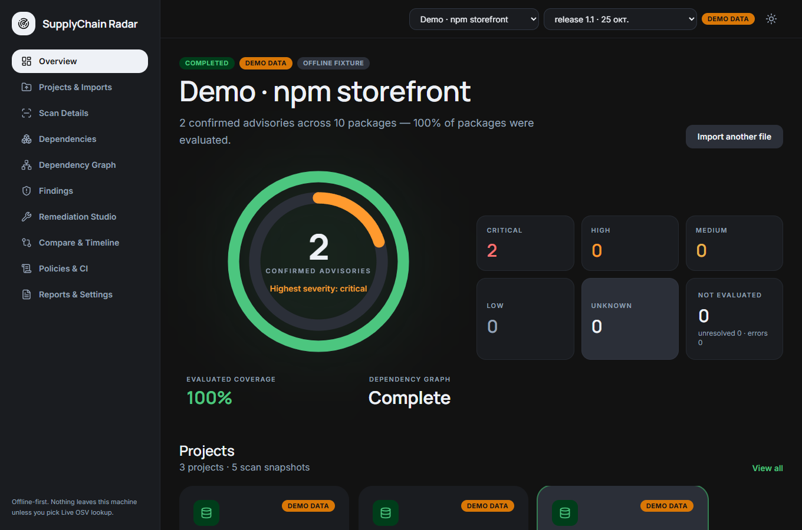
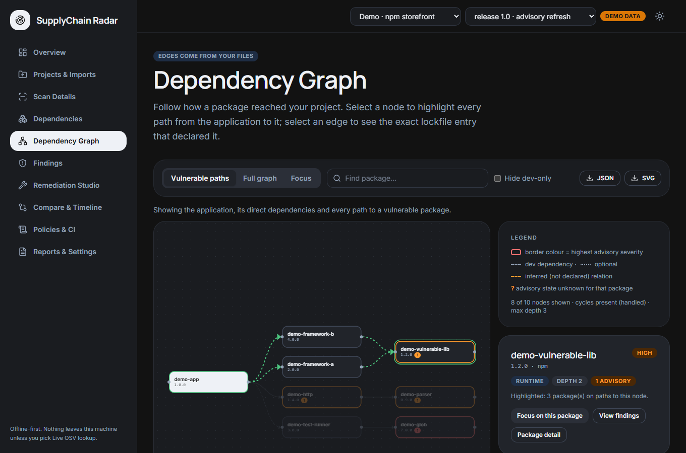
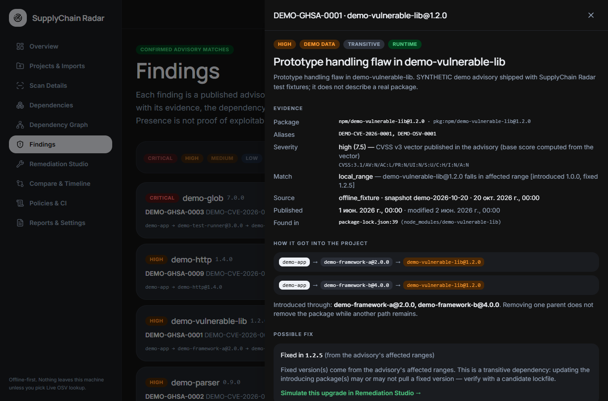
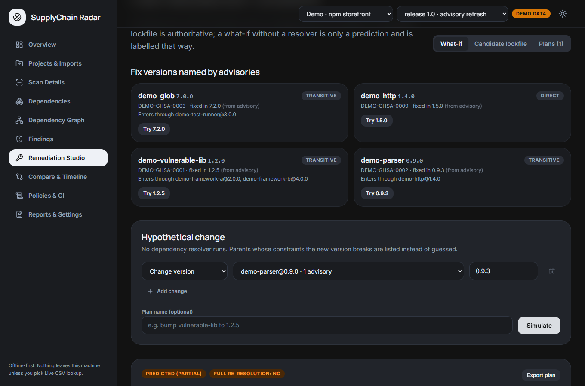
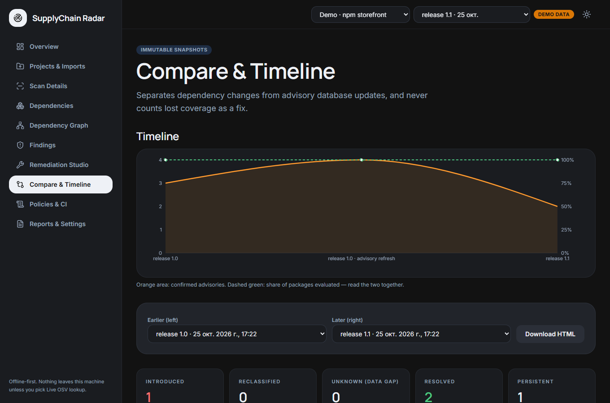
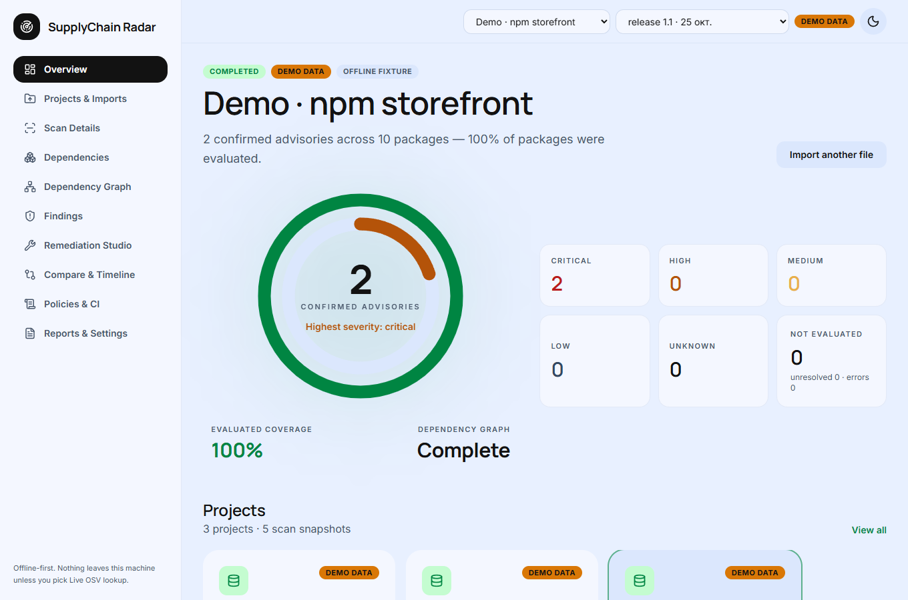
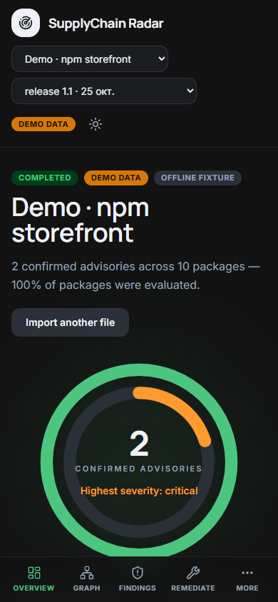

# SupplyChain Radar

**Know what you depend on, why it is there, which known advisories apply, what changed — and which upgrade could remove the risk.**

SupplyChain Radar is an offline-first software supply chain security workbench. It reads lockfiles and SBOMs *statically*, builds the real dependency graph, matches resolved packages against [OSV](https://osv.dev) advisories, and then explains every finding: the exact package version, the path(s) through which it entered your project, the evidence behind the match, and what a fix would and would not change.



> The screenshots show **synthetic demo data** (packages named `demo-*`, advisories named `DEMO-*`). They come from the real UI running on the real API, and the UI labels demo data wherever it appears.

| Dependency path explorer | Finding with evidence | Remediation Studio |
|---|---|---|
|  |  |  |

| Compare & timeline | Light theme | Mobile |
|---|---|---|
|  |  |  |

## What makes it different

- **Why, not just what.** Every finding lists all dependency paths from your application (`app → framework-a → vulnerable-lib`, `app → framework-b → vulnerable-lib`) and the file/line in the lockfile that declared each edge. Removing one parent does not make a package disappear while another path remains — the tool shows that.
- **Honest unknowns.** A package that was not evaluated, is unresolved, or has no data is *unknown* — never "clean". Offline cache misses are `not_evaluated`. Lost coverage is never reported as a fix.
- **Remediation Simulator.** Authoritative mode rescans a real candidate lockfile with the same advisory data. Hypothetical mode (no resolver) is always labelled a *prediction*, lists parent constraints the new version would break, and never claims full re-resolution.
- **Advisory updates ≠ dependency changes.** Comparing two scans separates `introduced by a new dependency version` from `introduced by a newer advisory database`.
- **Policy-as-code** with explicit exit codes, baselines for *new*-finding rules, expiring exceptions with an audit trail, and unknown severity treated as unknown (not as "below threshold").
- **Static and bounded.** Nothing is installed or executed; inputs are size/depth limited; ZIPs are read in memory with zip-slip, symlink and bomb protection.

## 60-second quickstart

### Option A — Docker (web UI + API)

```bash
docker compose up --build -d
# open http://127.0.0.1:8000  (published on loopback only)
```

### Option B — Python (CLI + UI)

```bash
python -m venv .venv && . .venv/bin/activate        # Windows: .venv\Scripts\activate
pip install -e "backend[dev]"
(cd frontend && npm ci && npm run build)             # optional: builds the web UI
supplychain-radar serve                              # http://127.0.0.1:8000
```

### First scan, fully offline and reproducible

```bash
supplychain-radar scan examples/npm-vulnerable \
  --offline --advisory-fixture fixtures/osv/frozen-advisories.json --demo
```

In the UI: **Overview → Load demo data** creates three clearly labelled demo projects, including a release-to-release comparison.

## What it finds — and what it does not determine

It reports *published advisories matched to exact package versions*, with the source's own severity. It does **not** determine exploitability or reachability, does not detect malware or compromised maintainers, and "no advisories" means "none in the data source and snapshot shown". See [docs/limitations.md](docs/limitations.md).

## Supported inputs

| Input | Versions validated by tests | Level |
|---|---|---|
| `package-lock.json` / `npm-shrinkwrap.json` | lockfileVersion 2, 3 (v1 rejected with a clear message) | full graph |
| `pnpm-lock.yaml` | 6.x, 9.x (workspaces / importers, peer-suffix variants merged) | full graph |
| `poetry.lock` (+ `pyproject.toml`) | lock-version 1.x, 2.x | full graph; direct deps need `pyproject.toml`, otherwise inferred and labelled |
| `requirements.txt` | exact `==` pins only | **partial**: ranges/unpinned/VCS/`-r` stay unresolved; no transitive graph |
| CycloneDX JSON | 1.6, 1.7, validated against the official JSON schemas | graph as declared; missing edges reported, never invented |
| SPDX JSON | 2.3 (structural validation, listed relationship types) | graph from `DEPENDS_ON` & friends |
| Folder / `.zip` | bounded depth/count/size; symlinks skipped; ZIP read in memory | — |

Details: [docs/supported-formats.md](docs/supported-formats.md).

## CLI

```bash
supplychain-radar scan ./examples/npm-vulnerable --format table
supplychain-radar scan ./examples/npm-vulnerable --offline \
  --advisory-fixture ./fixtures/osv/frozen-advisories.json -f json -o ./out/scan.json
supplychain-radar scan ./examples/npm-vulnerable -f sarif -o ./out/results.sarif --advisory-fixture ./fixtures/osv/frozen-advisories.json
supplychain-radar compare ./out/before.json ./out/after.json -f html -o ./out/diff.html
supplychain-radar policy check ./out/scan.json --policy ./examples/policy-strict.yaml --baseline ./out/before.json
supplychain-radar import validate ./examples/sbom-cyclonedx/bom.cdx.json
supplychain-radar remediate candidate ./out/scan.json ./examples/npm-remediated --advisory-fixture ./fixtures/osv/frozen-advisories.json
supplychain-radar remediate propose ./out/scan.json --set demo-parser@0.9.3 --advisory-fixture ./fixtures/osv/frozen-advisories.json
```

Real output (frozen demo snapshot):

```text
$ supplychain-radar policy check out/after.json --policy examples/policy-strict.yaml --baseline out/before.json
policy strict-new-findings: FAIL (exit 1)
  FAIL no-new-critical: new critical advisory DEMO-GHSA-0004 in demo-newdep@2.0.0
  WARN high-runtime-review: critical advisory DEMO-GHSA-0004 in demo-newdep@2.0.0
  suppressed DEMO-GHSA-0003 on demo-glob: accepted_risk until 2027-03-31
```

| Exit code | Meaning |
|---|---|
| `0` | scan completed, policy passed (warnings allowed) |
| `1` | policy gate failed |
| `2` | malformed input, invalid policy or usage error |
| `3` | scanner/provider error (e.g. OSV unreachable) |
| `4` | incomplete evaluation when failing closed (`unknown_data.mode: fail` or `--fail-on-incomplete`) |

Diagnostics go to stderr; machine-readable output to stdout or `--output` (written atomically, never overwriting without `--overwrite`).

## Web UI

Ten screens: Overview, Projects & Imports, Scan Details, Dependencies, Dependency Graph (React Flow), Findings (evidence, score breakdown, triage with expiry), Remediation Studio, Compare & Timeline, Policies & CI, Reports & Settings. **Dark is the default theme**; the toggle is in the top bar. Everything shown comes from stored scans — a fresh install shows an empty state with no placeholder numbers.

## Data sources, freshness, privacy

| Mode | Network | Notes |
|---|---|---|
| Offline — OSV cache | none | misses are `not_evaluated` |
| Frozen snapshot (`--advisory-fixture`) | none | reproducible; absence = absent from *that snapshot* |
| Live OSV | `api.osv.dev` | sends **only** ecosystem, package name, version; redirects are never followed; batched, retried with backoff, cached with `fetched_at` |

No telemetry. Imported files are parsed in memory; only the normalised inventory and results are stored (SQLite). Reference URLs from advisories are displayed as text and never fetched.

## Remediation: authoritative vs hypothetical

| Mode | How | Status label |
|---|---|---|
| Candidate lockfile | you provide a resolved lockfile/SBOM; it is scanned with the same advisory source | `confirmed_by_candidate_scan` |
| What-if | change a version or remove a direct dependency without a resolver | `predicted_partial` (or `unknown` / `blocked`) |

Plans are saved and can be compared (`advisories_removed`, `remaining`, `newly_introduced`, `dependencies_changed`, `unresolved_constraints`, `coverage_delta`). The tool never edits your lockfiles.

## Benchmarks (read the caveats)

Measured with [`scripts/benchmark.py`](scripts/benchmark.py) (Windows 11, AMD64, Python 3.14.4, single run, results in [`docs/benchmark-results.json`](docs/benchmark-results.json)): a generated **10,000-package** lockfile (19,675 edges) parses in ~0.22 s and the full analysis (graph, matching, up to 20 paths for each of 10 findings) takes ~0.22 s; the 1,000-package case takes ~0.33 s. Path searches report `truncated` instead of silently stopping. The graph UI shows a bounded subgraph (default: paths to vulnerable packages; full view capped at 800 nodes with search/focus) — browser rendering performance was not benchmarked. Fixture precision/recall is 1.0/1.0 against **synthetic fixtures written by the authors**, so it shows the matcher implements the fixture semantics, not that it is accurate on real ecosystems. See [docs/benchmarking.md](docs/benchmarking.md).

## Architecture and security

One Python engine (`backend/src/scradar`) is used by the CLI, the FastAPI server and the report generators; the React UI only talks to the API. See [docs/architecture.md](docs/architecture.md), [docs/threat-model.md](docs/threat-model.md) and [SECURITY.md](SECURITY.md). Containers bind to `127.0.0.1`, run as non-root with a read-only root filesystem and dropped capabilities.

## Development

```bash
make setup      # venv + python deps + npm ci
make check      # ruff, mypy, pytest, eslint, tsc, vitest, frontend build
make e2e        # Playwright journey (E2E_CHANNEL=msedge uses an installed Edge)
make benchmark
```

Layout: `backend/` (engine, CLI, API, tests) · `frontend/` (React + Vite + Tailwind) · `examples/` (demo projects) · `fixtures/` (frozen advisory snapshots, expected results) · `tests/e2e/` · `docs/`.

Deviations from the original brief (SQLite instead of Postgres, in-process job runner instead of Redis, no Scorecard/EPSS adapters) are listed in [IMPLEMENTATION_PLAN.md](IMPLEMENTATION_PLAN.md) and [docs/adr](docs/adr). Contributions: [CONTRIBUTING.md](CONTRIBUTING.md). License: [MIT](LICENSE).
