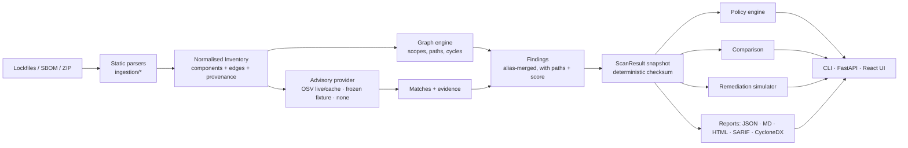

# Architecture

One engine, three front-ends: `scradar.service.analyze()` is the only function that turns inventories into a `ScanResult`. The CLI, the HTTP API and the remediation simulator all call it, so numbers cannot drift between surfaces.

## Modules (`backend/src/scradar`)

| Module | Responsibility |
|---|---|
| `domain/models.py` | Pydantic v2 models: `Component`, `Edge`, `Inventory`, `Finding`, `ScanResult`, query states |
| `ingestion/` | `npm`, `pnpm`, `poetry`, `requirements`, `cyclonedx`, `spdx` parsers; `detect` (format sniffing, folder/ZIP import, merging); `common` (bounded loaders, purl helpers, `InventoryBuilder`) |
| `versions.py` | Ecosystem-specific comparison: SemVer 2.0 (npm, Go, crates…) and PEP 440 (PyPI); npm range evaluator for what-if constraints |
| `graph/engine.py` | Multigraph, scope derivation, shortest-first bounded path search, introducers, cycle detection |
| `intelligence/` | `osv_model` (OSV records, CVSS v3 scoring, range matching), `providers` (OSV HTTP + cache, frozen fixture, null provider) |
| `findings/scoring.py` | Transparent 0–100 prioritisation (see [scoring-methodology.md](scoring-methodology.md)) |
| `service.py` | `analyze()`, alias grouping, fingerprints, coverage, deterministic checksum |
| `comparison/diff.py` | Scan diff: introduced / persistent / resolved / reclassified / unknown-due-to-data-gap, with causes |
| `policy/engine.py` | YAML policy, baselines, exceptions, exit codes |
| `remediation/simulator.py` | Candidate-lockfile and hypothetical simulations, plan comparison |
| `reports/render.py` | All export formats from the same `ScanResult` |
| `cli/main.py` | Typer CLI |
| `api/` | FastAPI app, SQLAlchemy persistence (SQLite), job runner |

## Key semantics

* **Query state per package**: `evaluated`, `cached`, `not_evaluated`, `unsupported`, `error`. Only `evaluated`/`cached` can ever produce "no advisories".
* **Nodes are `ecosystem:name@version`.** Several install locations of the same version share one node and keep all `locations`; different versions stay separate nodes. Workspace packages are first-party nodes and are excluded from advisory coverage.
* **Edges carry provenance** (`file`, `line`, `detail`) and `confidence` (`declared` / `inferred`). Paths over inferred edges are flagged.
* **Snapshots are immutable.** A `ScanResult` is stored as JSON; its `checksum` ignores scan id and timestamps, so the same inputs + same advisory snapshot + same engine version reproduce it exactly.
* **Fingerprint** = hash(ecosystem, name, version, primary advisory id). The primary id is chosen deterministically (GHSA > PYSEC > RUSTSEC > GO > OSV > CVE) from the alias-merged group.

## API & jobs

`/api/v1` REST API with OpenAPI at `/api/docs`. Mutating calls require the `X-Scradar-Request: 1` header (forces a CORS preflight that is never granted) and, when `SCRADAR_API_TOKEN` is set, a bearer token. Scans run on a small in-process thread pool with states `queued → parsing → enriching → analyzing → completed | partial | failed | cancelled`; cancellation is cooperative; `Idempotency-Key` prevents duplicate scans for retried uploads.

## Deviations from the original brief

See [adr/0001-sqlite-and-in-process-jobs.md](adr/0001-sqlite-and-in-process-jobs.md) and [adr/0002-ui-stack.md](adr/0002-ui-stack.md).
