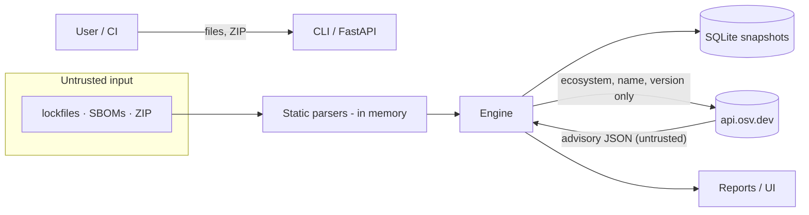

# Threat model

SupplyChain Radar processes **hostile data**: lockfiles, SBOMs, advisories and archives written by third parties. It is designed as a local tool: the API listens on loopback, there is no multi-tenant mode and no telemetry.

## Data flow and trust boundaries

Boundaries: (1) uploaded/imported bytes → parsers; (2) advisory JSON from OSV → engine; (3) engine output → HTML/Markdown/UI (rendering); (4) browser ↔ local API.

## Abuse cases and mitigations

| # | Abuse case | Mitigation | Test |
|---|---|---|---|
| 1 | Malicious lockfile with install scripts expects `npm install` | Nothing is ever executed; parsers only read data | `test_imported_content_is_never_executed` |
| 2 | Zip-slip, absolute paths, drive letters, symlinks in a ZIP | Names validated before use; entries read in memory, never extracted; symlink entries rejected | `test_zip_slip_rejected`, `test_zip_symlink_rejected` |
| 3 | Decompression/archive bombs, entry floods | Entry count, per-file and total size, compression-ratio limits | `test_zip_bomb_and_entry_limits` |
| 4 | YAML entity expansion ("billion laughs") | Custom `SafeLoader` that rejects aliases/anchors | `test_yaml_alias_bomb_rejected` |
| 5 | Deeply nested JSON / huge files | Size limit before parsing; `RecursionError` mapped to a clean error | `test_deep_json_and_oversize_rejected_safely` |
| 6 | Parser crash on garbage | Property tests: only `IngestError` may escape | `test_parsers_only_fail_with_ingest_error` |
| 7 | Cyclic or explosive graphs (DoS) | Cycle-safe traversal; shortest-first path search with node/time/path caps and explicit `truncated` flag | `test_cycles_terminate…`, `test_deep_shared_graph…` |
| 8 | SSRF through URLs in manifests/advisories | The only outbound host is the configured OSV base URL; redirects are never followed; non-loopback `http` is refused; advisory/manifest URLs are shown as text, never fetched | `test_osv_does_not_follow_redirects`, `test_osv_rejects_non_https…` |
| 9 | Data exfiltration through lookups | Requests contain only ecosystem, name, version; asserted by tests; offline modes open no sockets | `test_osv_live_sends_only_package_identity`, `test_offline_modes_open_no_sockets` |
| 10 | Stored/reflected XSS via package names or advisory text | React escapes by default; HTML report escapes every dynamic value and ships a `default-src 'none'` CSP; Markdown escapes metacharacters; SVG export escapes labels | `test_reports_share_facts_and_escape_html`, `graph.test.ts` |
| 11 | Secret leakage (index URLs with credentials, tokens in text) | Redaction of URL credentials and common token shapes in warnings, locations, errors and reports | `test_requirements_partial_semantics_and_redaction`, `test_redaction` |
| 12 | Cross-site request against the local API | Custom header required on mutations (forces CORS preflight, never granted); `TrustedHostMiddleware` blocks DNS-rebinding hosts; optional bearer token | `test_mutations_require_csrf…`, `test_host_header_is_restricted` |
| 13 | Exposing the service publicly by accident | Default bind 127.0.0.1; compose publishes on loopback only; CLI warns when binding elsewhere without a token | — |
| 14 | A provider outage producing a "clean" report | Errors become `error` state; coverage < 100 % is shown everywhere; policy can fail closed (exit 4) | `test_osv_failure_is_error_state_not_clean`, E2E outage test |
| 15 | Alias duplicates inflating or hiding findings | Union-find alias grouping; deterministic primary id and fingerprint | `test_alias_duplicates_produce_one_finding` |
| 16 | Container breakout / privilege | Non-root user, read-only root FS, all capabilities dropped, `no-new-privileges`, no Docker socket or host mounts | compose config |

## Residual risks
* An attacker who controls an advisory feed can mislead results; OSV responses are validated structurally and matched locally where a comparator exists, but not cryptographically authenticated beyond TLS.
* Frozen fixtures and caches can be stale; freshness is displayed but not enforced.
* The API token (if used) is stored in the browser's `localStorage`; use only on trusted machines.
* The UI renders advisory *links* as clickable `https` URLs; clicking them is a user decision.
* SQLite files are not encrypted; stored data is normalised metadata, not raw uploads.
* Dependency confusion cannot be detected: private-registry packages are looked up by name against public data unless sources are non-registry (then they are *unsupported*).
